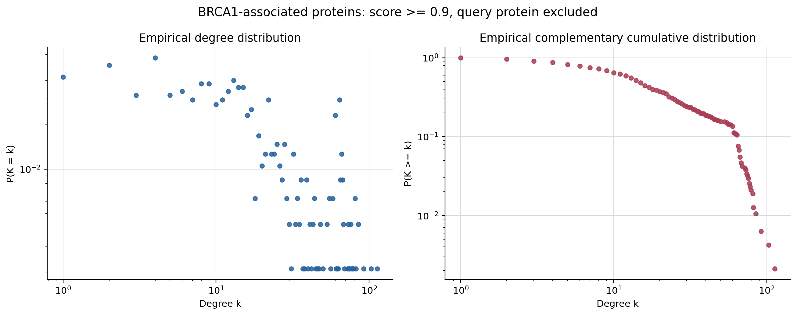
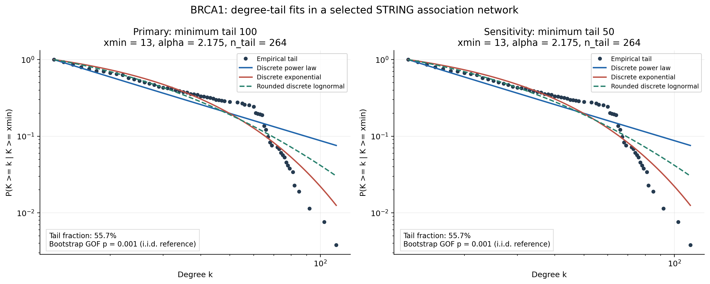
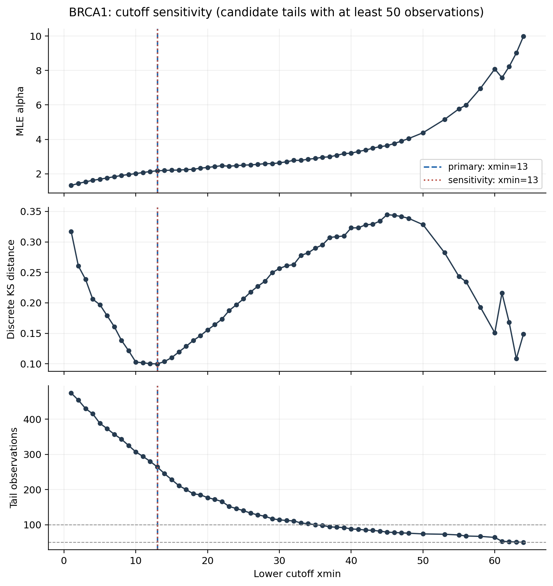

# BRCA1 Protein-Association Network: Topology and Degree-Tail Analysis

A reproducible, exploratory analysis of a human protein-association network exported from **STRING** using **BRCA1** as the query protein. The project describes the filtered network's degree distribution, centrality rankings and topological communities, and examines whether a fitted discrete power-law tail is compatible with the observed degrees.

The analysis concerns this selected local network. It does not establish a disease mechanism, a protein's biological essentiality, or a scale-free organization of the complete human interactome.

## Data and provenance

| Item | Value |
| --- | --- |
| Supplied input | `string_interactions_short_501_nodes.tsv` |
| Source | STRING interaction export |
| Organism | *Homo sapiens*, taxonomy ID `9606` |
| Query protein | `BRCA1` |
| Rows in the supplied export | 22,715 |
| Distinct protein labels in the export | 501 |
| Observed combined-score range | 0.400–0.999 |
| Analysis threshold | `combined_score >= 0.9` |
| STRING release and original download date | Not recorded |
| Original network mode, evidence-channel selection and shell/expansion settings | Not recorded |

The organism and query correspond to the original project description; all supplied STRING protein identifiers have the `9606` prefix. The observed minimum score of 0.4 is a property of the supplied file, not independent verification of the original download settings. No current database query is required to reproduce the analysis of this snapshot.

SHA-256 of the unmodified input file:

```text
c023c2ca1be958ee44337bda617b55dfa7cb72ef12fa49d94fd6faf8e280b862
```

STRING scores describe confidence in an association; they do not measure interaction strength or establish direct physical binding. Depending on network type and evidence, associations can reflect functional relationships or physical proximity. The supplied export does not independently establish that every retained edge is a direct, experimentally verified interaction. [1]

## Graph construction

1. Read the supplied tab-separated table and validate the endpoint and score columns.
2. Retain rows with `combined_score >= 0.9`.
3. Exclude `BRCA1` and its incident edges.
4. Construct a **simple, undirected, unweighted** graph from the remaining edge endpoints. The confidence scores determine edge inclusion and are not used as path lengths or centrality weights.

The supplied table contains no missing endpoint/score values, self-loops or repeated unordered pairs. Each protein label maps to one STRING identifier in this export.

The primary graph retains the original project's **active-endpoint** convention: a protein is included only if at least one retained edge connects it to another non-query protein. There are 500 non-query proteins in the raw export, of which **26 have no remaining retained edge** and are omitted as isolates. Consequently, the primary graph has **474 nodes**, and its degree distribution is conditional on having positive degree after preprocessing. Adding those 26 zero-degree proteins would change graph-wide averages and normalized centralities; the convention must be kept explicit when comparing results.

Excluding the query protein is a sensitivity choice, not a correction that makes the sample unbiased. The other proteins were still selected through a BRCA1-centered query. In the raw export BRCA1 is connected to all 500 other proteins; only 193 of those edges meet the 0.9 analysis threshold.

## Reproduced network summary

| Quantity | Result | Scope |
| --- | ---: | --- |
| Nodes | 474 | Positive-degree graph after query exclusion |
| Edges | 5,300 | Same graph |
| Mean degree | 22.362869 | Same graph |
| Mean local clustering | 0.551999 | Same graph, including nodes with local clustering zero |
| Density | 0.047279 | Same graph |
| Connected components | 3 | Component sizes: 469, 3 and 2 |
| Largest connected component (LCC) nodes | 469 | 98.945% of active nodes |
| LCC edges | 5,297 | LCC |
| Greedy modularity communities | 6 | LCC |
| Modularity | 0.506305 | LCC partition |

For context, `p = 2L / [N(N - 1)] = 0.047279` is the edge probability of a simple Erdos–Renyi model with the same expected edge count. The empirical mean clustering divided by this value is about **11.68**. This is a descriptive comparison with an **analytic reference**, not an ensemble-based significance test. It is not a small-world coefficient: small-world assessment also requires an appropriate path-length comparison. [2]



## Centrality and communities

Degree centrality is `degree / (N - 1)` on the full 474-node analysis graph. Betweenness is the normalized, unweighted shortest-path betweenness on that same graph. These quantities describe the selected network; they are not direct measures of biological causation or essentiality.

| Rank | Protein by degree | Degree | Degree centrality | Protein by betweenness | Betweenness |
| --- | --- | ---: | ---: | --- | ---: |
| 1 | TP53 | 113 | 0.238901 | TP53 | 0.135109 |
| 2 | H4C6 | 103 | 0.217759 | PCNA | 0.068237 |
| 3 | H2AX | 92 | 0.194503 | PLK1 | 0.064476 |
| 4 | EP300 | 85 | 0.179704 | RAD51 | 0.064334 |
| 5 | H3-3B | 85 | 0.179704 | H4C6 | 0.047104 |

The two rankings answer different topological questions. For example, PCNA ranks below the largest-degree hubs but ranks second in betweenness in this graph. That observation does not, by itself, establish a biological pathway or a therapeutic role.

Community detection uses greedy modularity maximization on the LCC. The reproduced community sizes are **185, 147, 85, 27, 15 and 10**. These are **topological communities**. Modularity evaluates the partition using graph connectivity; a value above 0.5 is not a biological validation threshold. Functional interpretation would require separate evidence and a suitable analysis design. [3]


## Degree-tail inference

The previous straight-line regression on a log–log CCDF has been replaced by a discrete probability model. A visually straight CCDF or a regression slope alone does not establish a power law. The statistical approach follows the framework of Clauset, Shalizi and Newman. [4]

For integer degree observations `x >= xmin`, the fitted model is

$$
P(X=x\mid X\ge x_{\min}) = \frac{x^{-\alpha}}{\zeta(\alpha,x_{\min})},
\qquad \alpha>1,
$$

where `zeta` is the Hurwitz zeta function. `alpha` is the fitted exponent and `xmin` is the lower cutoff; these names are retained throughout the inference outputs.

The analysis estimates `alpha` by exact discrete maximum likelihood and selects `xmin` by minimizing a Kolmogorov–Smirnov discrepancy over the eligible integer cutoffs. The primary analysis requires **at least 100 tail observations**, matching the rule used in the companion synthetic BA/ER experiment. A separate sensitivity analysis relaxes this constraint to **50 observations**. These thresholds are declared analysis choices, not guarantees of adequate precision. The same rules are used in the companion APP analysis.

The KS calculation accounts for the full integer support, including gaps between observed degrees. Tail counts and tail fractions are reported alongside the fitted exponent so that a fit to a small subset cannot be mistaken for a description of all nodes. The exported cutoff scan shows how the result changes with `xmin`; no cutoff is selected because it produces a preferred exponent or p-value.

Goodness of fit is calibrated using **1,000 semiparametric bootstrap replications for each minimum-tail policy**: the observed body below `xmin` supplies the empirical lower distribution, and the fitted model supplies the tail. Both `xmin` and `alpha` are fitted again to each synthetic sample using that policy's selection rule. The outputs include the exceedance count and Monte Carlo uncertainty so that a finite simulation is not mistaken for an exact p-value.

The `powerlaw` package supplies an independent fixed-`xmin` check of the discrete power-law exponent, with its discrete approximation disabled. Its exponential and round-discretized lognormal models are compared with the power law on the **same observed tail**. AIC comparisons are conditional on that selected tail. `p_lr` is the likelihood-ratio comparison p-value; it is distinct from the bootstrap goodness-of-fit `p_bootstrap`. In particular, a failure to reject the power law is not evidence that it fits better than those alternatives. [4, 5]

### Executed degree-tail results

The full 474-value positive-degree sample produces the following results:

| Analysis | Minimum tail size | `xmin` | `alpha` | Tail observations | Tail fraction | KS | `p_bootstrap` |
| --- | ---: | ---: | ---: | ---: | ---: | ---: | ---: |
| Primary | 100 | 13 | 2.174928 | 264 | 55.70% | 0.099775 | 0.000999 |
| Sensitivity | 50 | 13 | 2.174928 | 264 | 55.70% | 0.099775 | 0.000999 |

Both policies select the same observed tail. In each run **0 of 1,000** refitted bootstrap samples have a KS discrepancy at least as large as the observed value. The reported value uses the add-one rule `(exceedances + 1) / (B + 1)`, giving `1/1001`; it must not be read as an exactly known probability or replaced by zero. The 95% Wilson interval for the Monte Carlo exceedance probability is approximately **0 to 0.00383**. This interval describes simulation uncertainty, not uncertainty in `alpha`.

**The fitted unbounded power-law tail is a poor description under the stated independent-observation reference model.** This result is stable to the two minimum-tail rules tested here. It does not provide support for calling this selected network scale-free. The graph-dependence and sampling limitations below remain relevant to the calibration of the p-values.

The package independently estimates `alpha = 2.174904` at the same `xmin`, differing from the exact custom optimization by approximately `0.000024`.

The models are fitted to the same 264 observations with `xmin = 13`, so the following table applies to both policies:

| Model | Log likelihood | Parameters | AIC | Delta AIC | `R_powerlaw_vs_model` | `p_lr` |
| --- | ---: | ---: | ---: | ---: | ---: | ---: |
| Discrete exponential | -1089.829393 | 1 | 2181.658787 | 0.000000 | -23.431073 | 0.001044 |
| Rounded discrete lognormal | -1094.288927 | 2 | 2192.577854 | 10.919067 | -18.971540 | 0.000138 |
| Discrete power law | -1113.260467 | 1 | 2228.520933 | 46.862146 | — | — |

The discrete exponential has the lowest AIC **among these three models on this tail**. For the raw likelihood ratio `R`, positive values favor the power law and negative values favor the listed alternative. The ratio-test p-values also use an independent-observation reference. No separate absolute goodness-of-fit test is performed for the exponential or lognormal alternatives, so their relative preference does not establish that either is an adequate data-generating model.





### Interpretation limits

- A small bootstrap p-value indicates a poor fit under the tested sampling model. A large p-value means that this test did not reject that model; it does not prove that the network is scale-free.
- Network degrees are dependent observations and are bounded by the size of their graph. The independent-observation bootstrap is therefore an exploratory degree-distribution diagnostic, not a graph-level significance test. Its simulated degree samples are not required to be graphical sequences.
- The unbounded discrete power law is a tail approximation. Finite network size, thresholding, query-based selection and edge dependence limit interpretation even when the approximation is not rejected.
- A model-comparison preference is relative to the included alternatives and the selected tail. It does not establish biological causation or remove sampling bias.
- Removing BRCA1 and omitting isolates are documented preprocessing choices. The conclusions apply to that resulting graph, not to all human proteins or an unbiased sample of them.
- The companion APP network is another selected neighborhood. Differences between the two exports are descriptive; the original acquisition settings are insufficiently documented to attribute those differences to entire biological subsystems.

## Reproduction

Install the dependencies and run the topology and degree-tail analyses from the project directory:

```bash
python -m pip install -r requirements.txt
python brca1_analysis.py
python fit_degrees.py
```

The raw input is supplied with the project, and paths are resolved relative to the script location. The topology and degree-tail modules are separate so that the statistical analysis can be rerun without regenerating the network drawing.

| Source file | Responsibility |
| --- | --- |
| `brca1_analysis.py` | Load and validate the supplied export; construct the graph; export topology, centrality, communities and descriptive figures |
| `fit_degrees.py` | Run the declared primary and sensitivity tail analyses on that same graph |
| `powerlaw_analysis.py` | Exact discrete MLE, cutoff selection, semiparametric bootstrap, model comparisons and inference figures |
| `requirements.txt` | Dependency ranges and the validated `powerlaw==1.5` package version |

The included results were generated with **Python 3.12.14**, NumPy 2.3.5, SciPy 1.17.0, pandas 2.2.3, Matplotlib 3.10.8, NetworkX 3.4.2 and `powerlaw` 1.5. The primary bootstrap seed is `2026`, the sensitivity seed is `2027`, and the layout seed is `42`. Exact software versions and settings are exported to `output/run_metadata.json`. Dependency ranges permit compatible installations, so small numerical, algorithmic tie-handling or drawing differences can occur across versions; use the recorded versions for the closest reproduction of the bundled outputs.

The discrete exponent optimization searches `1.000001 < alpha < 20`. A fit reaching either numerical boundary raises an error rather than silently reporting a clipped estimate.

### Topology outputs

| File | Contents |
| --- | --- |
| `output/network_summary.csv` | Preprocessing counts, input hash, graph conventions and topology summary |
| `output/node_metrics.csv` | Every active protein's degree, degree centrality, betweenness, connected component and LCC community label |
| `output/community_membership.csv` | Complete LCC community membership and community sizes |
| `output/degree_counts.csv` | Degree counts, empirical probability masses and inclusive CCDF |
| `degree_distribution.png` | Descriptive degree PMF and CCDF without a regression fit |
| `network_communities.png` | LCC drawing with community membership shown by color |

### Statistical outputs

| File | Contents |
| --- | --- |
| `output/fit_summary.csv` | Primary and sensitivity fits; `alpha`, `xmin`, tail count/fraction, KS, bootstrap p-value and Monte Carlo uncertainty; package exponent check |
| `output/xmin_sensitivity.csv` | Exact discrete fit at each scanned cutoff and eligibility under both minimum-tail policies |
| `output/model_comparison.csv` | Conditional log likelihoods, parameter counts, AIC, delta AIC and likelihood-ratio comparisons on each policy's common tail |
| `output/bootstrap_ks.csv` | Refitted KS statistic for every bootstrap replication |
| `output/tail_fits.png` | Empirical conditional-tail CCDFs and fitted alternatives for both policies |
| `output/xmin_sensitivity.png` | Cutoff sensitivity plot |
| `output/run_metadata.json` | Run settings, input hash and software versions |

The AIC values from the primary and sensitivity analyses must not be compared when the policies select different tails: they would describe different observations. Within either policy, all compared models use the same sample.

## References

1. STRING. [What is a STRING network? Scores, network types and reproducibility](https://en.string-db.org/help/scores/).
2. NetworkX. [Small-world analysis](https://networkx.org/documentation/stable/reference/algorithms/smallworld.html).
3. NetworkX. [Modularity](https://networkx.org/documentation/stable/reference/algorithms/generated/networkx.algorithms.community.quality.modularity.html).
4. Clauset, A., Shalizi, C. R., & Newman, M. E. J. (2009). [Power-law distributions in empirical data](https://arxiv.org/abs/0706.1062). *SIAM Review*, 51(4), 661–703. [doi:10.1137/070710111](https://doi.org/10.1137/070710111).
5. Alstott, J., Bullmore, E., & Plenz, D. (2014). [powerlaw: A Python Package for Analysis of Heavy-Tailed Distributions](https://doi.org/10.1371/journal.pone.0085777). *PLOS ONE*, 9(1), e85777.
