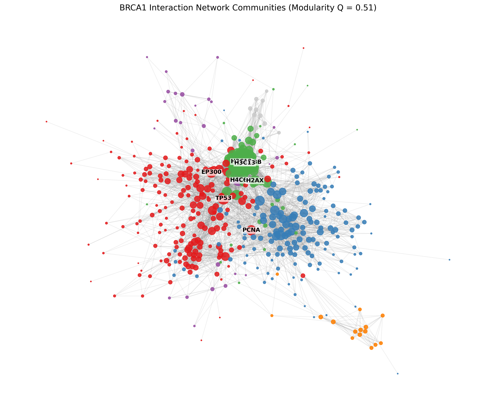

# Structural and Community Analysis of the Human BRCA1 Protein-Protein Interaction Network

## Overview
This repository presents an empirical complex network analysis of the human **BRCA1** Protein-Protein Interaction (PPI) network, extracted from the **STRING database** (*Homo sapiens*, Taxonomy ID: 9606). While theoretical generative models (such as the Barabási–Albert model) produce idealized scale-free topologies, real-world biological datasets often exhibit sampling biases and statistical noise. This project demonstrates data preprocessing, statistical characterization, centrality-based hub identification, and community structure detection on empirical biological data.

## Methodological Challenges & Data Preprocessing
1. **Mitigating Edge Noise:** The raw interaction dataset contained $22,715$ edges across $501$ proteins (`combined_score >= 0.4`). To eliminate false-positive predictions from automated text-mining and isolate biologically verified pathways, the network was filtered to retain only **Highest Confidence interactions (`combined_score >= 0.9`)**.
2. **Eliminating Ego-Network Sampling Bias:** Because the dataset was queried around BRCA1 (which artificially connects to all $500$ neighbors as a star-graph center), BRCA1 was removed prior to topological evaluation to uncover the intrinsic connectivity among its interacting partners.
3. **Handling Fat-Tail Noise via CCDF:** In finite real-world networks ($N = 474$), the raw degree distribution $P(k)$ exhibits high variance and a flat noise floor at large degrees. Following Barabási (*Network Science*, Ch. 4), we utilized the **Complementary Cumulative Distribution Function (CCDF, $P(K \ge k)$)** to smooth statistical fluctuations and accurately estimate the power-law scaling exponent ($\gamma$).

## Key Empirical Findings

### 1. Global Network Topology & Small-World Property
* **Nodes ($N$):** $474$
* **Edges ($L$):** $5,300$
* **Average Clustering Coefficient ($\langle C \rangle$):** $0.552$
* **Comparison with Random Null Model:** An equivalent Erdős–Rényi random graph ($N=474, L=5300$) yields an expected clustering coefficient of $C_{\text{rand}} \approx 0.047$. The empirical PPI network exhibits clustering nearly **12 times higher** than random expectation, confirming the presence of densely interconnected functional protein complexes.


### 2. Local Hubs vs. Global Network Bridges (Centrality Analysis)
Comparing **Degree Centrality** and **Betweenness Centrality** reveals a critical structural distinction between dense local cliques and global topological bridges:

| Rank | Protein | Degree Centrality | Degree ($k$) | Protein | Betweenness Centrality | Topological Role |
| :--- | :--- | :--- | :--- | :--- | :--- | :--- |
| **1** | **TP53** | 0.2389 | 113 | **TP53** | 0.1351 | Global Super-Hub & Pathway Bridge |
| **2** | **H4C6** | 0.2178 | 103 | **PCNA** | 0.0682 | DNA Replication / Repair Coordinator |
| **3** | **H2AX** | 0.1945 | 92 | **PLK1** | 0.0645 | Mitotic Signaling Bridge |
| **4** | **EP300** | 0.1797 | 85 | **RAD51** | 0.0643 | Homologous Recombination Broker |
| **5** | **H3-3B** | 0.1797 | 85 | **H4C6** | 0.0471 | Core Histone Connector |

* **The Master Regulator (`TP53`):** Ranks first in both metrics, holding almost double the betweenness score of the second-ranked node (0.1351 vs 0.0682). Biologically known as the *"Guardian of the Genome"*, TP53 acts as the primary topological bridge integrating DNA damage sensing, cell-cycle arrest, and apoptosis.
* **Histone Cliques vs. Functional Brokers:** Histone proteins (`H4C6`, `H2AX`, `H3-3B`, `H3C12`, `H3C13`) dominate the top 10 Degree Centrality list due to forming a tightly bound local structural complex (chromatin). However, most disappear from the top Betweenness list. Conversely, key signaling and repair proteins such as **`RAD51`**, **`PLK1`**, **`TP53BP1`**, and **`BARD1`** emerge as top Betweenness hubs, serving as essential inter-modular bridges across cellular pathways.

### 3. Community Structure & Modularity
Using the **Greedy Modularity Maximization** algorithm on the Largest Connected Component:
* **Detected Communities:** $6$ distinct functional modules
* **Modularity Score ($Q$):** **$0.506$**

A modularity score exceeding $0.5$ demonstrates pronounced functional segregation, partitioning the interaction partners into specialized biological machineries (e.g., cell-cycle regulation vs. homologous recombination repair and chromatin remodeling).



## Repository Structure & Usage
* `brca1_analysis.py` — Complete Python script for data filtering, CCDF power-law fitting, centrality ranking, and community visualization.
* `string_interactions_short_501_nodes.tsv` — Raw PPI dataset exported from STRING.
* `degree_distribution.png` — Log-log plot comparing raw degree distribution and CCDF power-law fit.
* `network_communities.png` — Network graph visualization highlighting communities and primary hubs.

To reproduce the analysis and figures:
```bash
pip install numpy pandas networkx matplotlib
python brca1_analysis.py
```